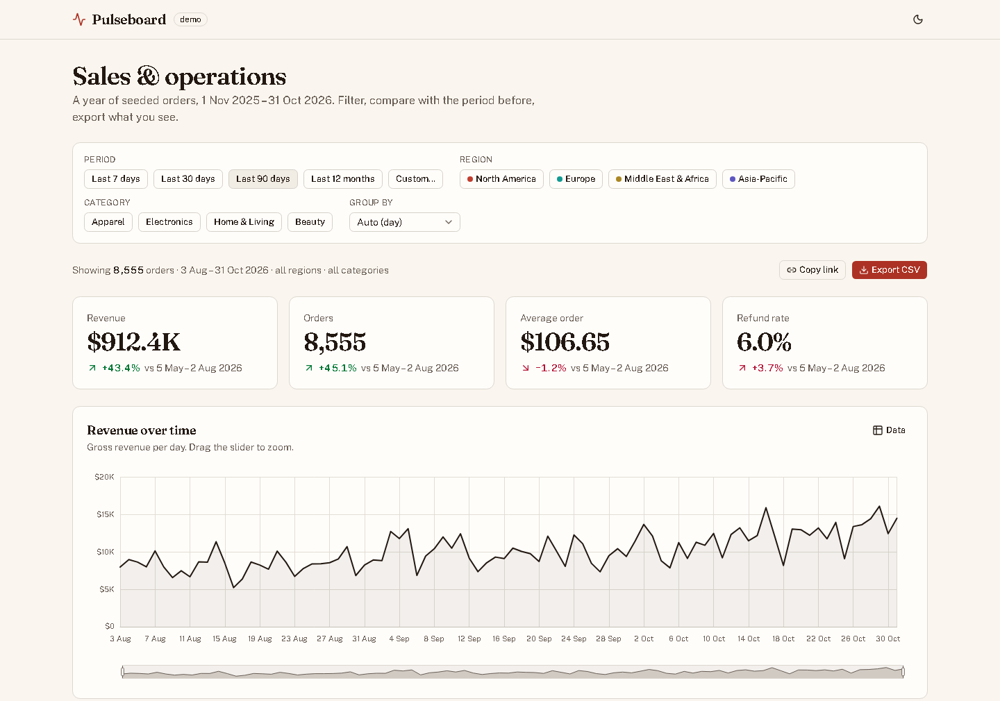

# Pulseboard

A sales and operations dashboard over a year of seeded orders: KPI tiles with period-over-period change, four Apache ECharts charts, filters that live in the URL, and CSV export. No backend, so the demo never breaks.

[](https://github.com/Mostafa3ta/pulseboard/actions/workflows/ci.yml)

**Live demo:** _coming soon_



## What it shows

About 31,000 orders across four regions and four categories, generated in the browser from a fixed seed so every visitor sees the same numbers. Pick a period, narrow by region or category, and everything below the filter bar agrees: four KPI tiles compare the period with the one of equal length just before it, and four charts re-render against the same slice. The URL carries the filters, so a view can be shared by copying the address. Export writes exactly the orders you are looking at to a CSV file.

## Features

- **KPI tiles**: revenue, orders, average order and refund rate, each with its change against the previous period of the same length ("vs 5 May – 2 Aug 2026"). A fall in refund rate reads as good; an arrow and a sign carry the direction, never colour alone
- **Four charts** (Apache ECharts): revenue over time with a range slider, orders by category stacked by region, revenue share by region, and orders by weekday × hour as a heatmap
- **Filters in one row**: presets (7, 30, 90 days, 12 months) or a custom range validated with Zod; region and category chips; group by day, week or month, or let the range decide
- **URL-synced state**: `?from=2026-01-01&to=2026-03-31&region=eu&category=home,beauty&g=week` reproduces a view exactly. Malformed values fall back to defaults instead of breaking the page. "Copy link" puts the address on the clipboard
- **Every chart has a table twin** behind its Data button, and a one-sentence description for screen readers
- **Empty state** when nothing matches, **CSV export** of the filtered orders, **light and dark themes** (the charts re-theme with the page), reduced-motion safe, usable on a phone

## Stack

Next.js 15 (App Router) · React 19 · TypeScript · Tailwind CSS 4 · shadcn/ui (Radix) · Apache ECharts 6 · React Hook Form + Zod · Vitest + React Testing Library · Playwright · GitHub Actions · Cloudflare Pages

## Key decisions

**Aggregate in `lib/`, draw in components.** Every figure comes from a pure function over the filtered orders (`computeKpis`, `revenueSeries`, `ordersByCategory`, `revenueByRegion`, `heatmapCells` in `lib/aggregate.ts`), memoised in the dashboard. Chart components receive finished arrays and turn them into an ECharts option; they never see a raw order. The cost is one more layer than calling ECharts directly. It pays for itself the first time a number needs a unit test, and again because the table twins and the CSV export reuse the same functions, so the chart, its table and the download cannot disagree.

**One typed ECharts wrapper.** `components/charts/chart.tsx` is the only file that imports ECharts. It registers just the chart types and components the app uses (the rest is tree-shaken), owns the instance for the life of its element, resizes with its container through a ResizeObserver, switches theme when the page does, and turns animation off under `prefers-reduced-motion`. The four chart option builders in `components/charts/options.ts` are pure functions with their own tests. Swapping the chart library would touch one file and four builders, not the data path.

**The filters are the URL.** The dashboard keeps no filter state of its own. It parses `useSearchParams`, and every change goes through `history.replaceState`, which Next.js feeds back into the router without a server round trip. A link reproduces a view, the back button is not polluted (replace, not push), and the end-to-end tests set up any state by visiting an address. Parsing is defensive: a reversed range, an unknown region, a date outside the data all fall back rather than fail.

**A fixed dataset, with presets relative to it.** The data covers 1 Nov 2025 – 31 Oct 2026 and never moves, so "Last 30 days" means the last 30 days of data. Anchoring to today would change every number daily and make the tests and the screenshot meaningless. A real dashboard would anchor to today; the shape of the code would not change.

**Colour validated, not eyeballed.** The four series colours (terracotta, teal, gold, indigo) are stepped separately for the light and dark surfaces and were checked for separation under simulated colour-vision deficiency and for 3:1 contrast against each surface. Regions keep their colour and their order in every chart, legend and filter chip. The heatmap uses one hue, light to dark. Text never wears a series colour.

## Run and test

```bash
npm install
npm run dev          # http://localhost:3000
npm test             # unit and component tests (Vitest)
npm run test:e2e     # end-to-end tests in a real browser (Playwright), desktop and mobile
npm run build        # production build
```

On a new machine, install the Playwright browser once: `npx playwright install chromium`.

What the tests cover: the seeded generator (deterministic, in range, retail-shaped); period keys, presets and the previous-period rule; URL parsing and serialisation round trips; every aggregation; CSV escaping and the export file; number and date formats; the four chart option builders; the KPI tile's direction and sentiment; the filter bar's presets, chips, custom-range validation and reset. End to end, in desktop and mobile Chrome: the default view's figures match the pure functions; changing the period changes the figures and the URL; a shared URL reproduces a view; a custom range is validated then applied; filters that match nothing show the empty state; the export downloads a CSV with one row per filtered order; each chart opens as a table; the theme toggle re-themes the page; nothing scrolls sideways.

## Known limits

- The whole dashboard is client-rendered after hydration, and ECharts is a large library even tree-shaken, so Lighthouse on a throttled phone scores the first load in the low 70s for performance (100 for accessibility, best practices and SEO; 94 on desktop). The charts load in their own chunk after the first paint and each one initialises in its own task, which is what moved it from the 50s. Rendering the first view on the server with a real data source would be the next step.
- The zoom slider under the revenue chart is a pointer control. Keyboard users have the presets, the custom range and the table twin for the same job.
- In the dark theme, terracotta and gold are hard to tell apart for some readers with deuteranopia if they sit next to each other. They never do: the region order is fixed in every chart, so those two are always separated by teal or indigo, and the legend and tables carry the names.

## What I'd do next

- A real data source: replace `getOrders()` with a fetch of the same shape, holding the previous render at reduced opacity while the next slice loads
- A compare mode that overlays the previous period on the revenue line, since the KPI deltas already know what it is
- Drill-down from a heatmap cell or a bar to the orders behind it, in the same table twin
